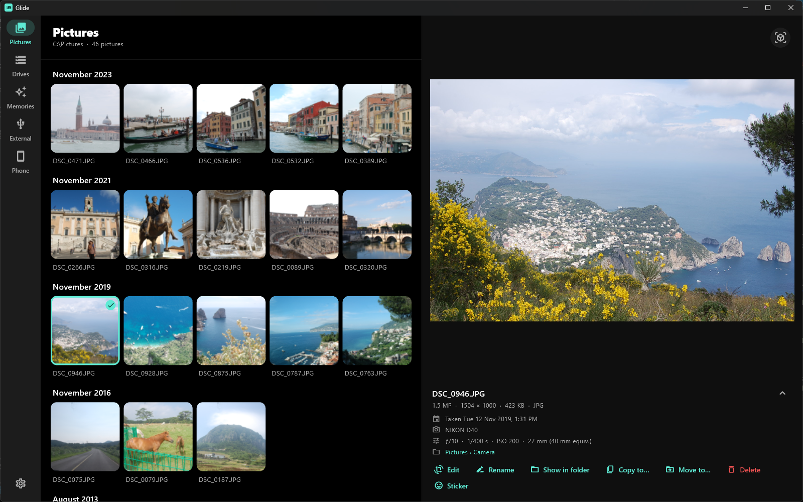
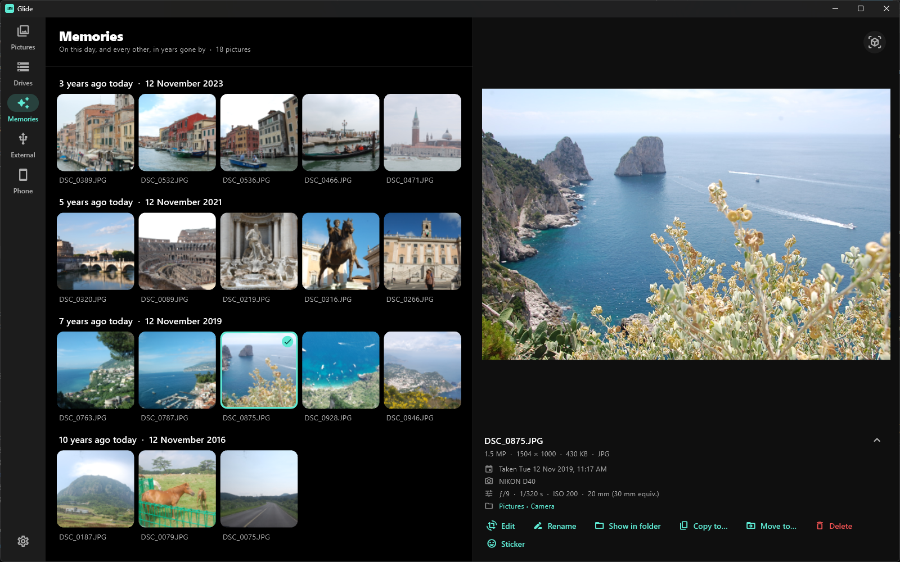
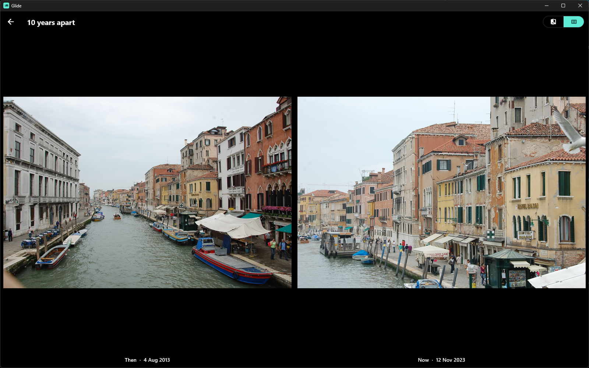
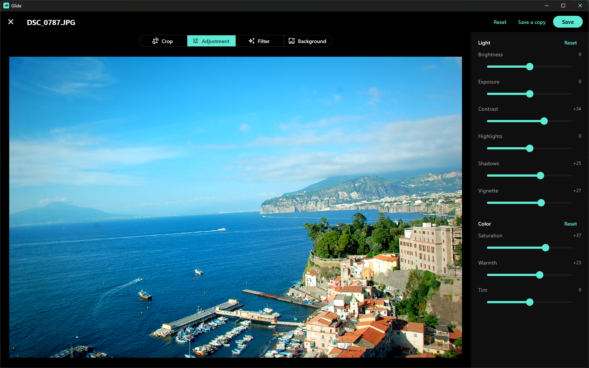
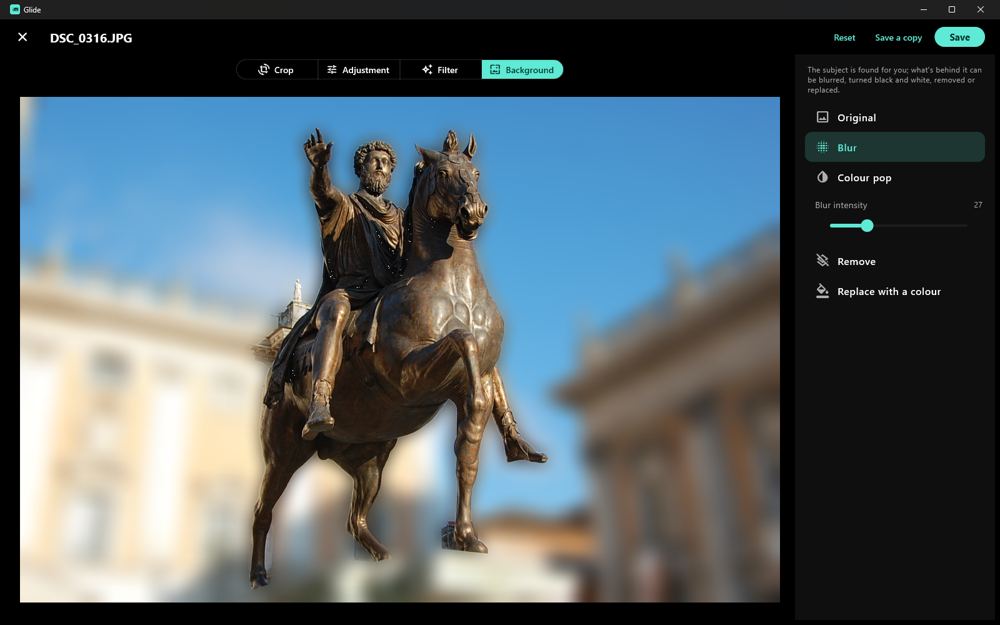

# Glide

Glide is a photo viewer for Windows that shows the pictures already on your PC:
no accounts, no ads, no internet. Every picture is there, newest first and
grouped by month, without any folders to click through.

<p>
  
</p>

<table>
  <tr>
    <td width="50%"><br><b>Memories:</b> on this day, years ago.</td>
    <td width="50%"><br><b>Compare:</b> then and now, side by side.</td>
  </tr>
  <tr>
    <td width="50%"><br><b>Edit:</b> crop, light, colour and filters.</td>
    <td width="50%"><br><b>Background:</b> blur it, colour-pop it or replace it.</td>
  </tr>
</table>

## Download

**Windows 10 and 11:** get `Glide-Setup.exe` from the
[latest release](../../releases/latest), or install it with
[Jeti](https://github.com/BersamaMus/Jeti), which keeps it up to date.

Windows may warn that the installer is from an unknown publisher. Click
**More info**, then **Run anyway**.

An Android version is on the way.

## Features

- **Every picture, by month:** dated by when it was taken (from the photo
  itself), not when it was copied. Photos and screenshots can be shown apart,
  and so can each file type.
- **Every source the same way:** Pictures, your other drives, a USB stick, and
  an Android phone plugged in by cable. Switch between them with chips at the
  top, and watch slow scans fill in as they go.
- **Memories:** what you took on this day in years past.
- **The formats cameras use:** JPG, PNG, GIF, WebP, BMP, HEIC, AVIF, TIFF, and
  RAW files from most cameras (with Windows' own codecs).
- **Edit a copy:** crop, rotate, light and colour adjustments, and filters.
  Blur or replace the background behind the subject, which Glide finds on your
  PC.
- **Make something new:** cut the subject out as a sticker, put a few pictures
  together in a collage, or compare two side by side, then and now.
- **Tidy up:** rename, copy, move, or send pictures to the Recycle Bin, one at a
  time or many at once, with File Explorer's selection and shortcuts.
- **Open with Glide:** offered for pictures in File Explorer.

Glide never reads OneDrive files that are only online, so it doesn't download
them.

## Building

Needs Flutter and Visual Studio with C++ (for the Windows side).

```sh
flutter pub get
flutter run -d windows
flutter test
powershell -File windows\installer\build_installer.ps1   # build\installer\Glide-Setup-<version>.exe
```

The first Windows build downloads ONNX Runtime and the IS-Net model (used to
find a picture's subject) into `packages/native_imaging/third_party/`.
Building the installer needs [Inno Setup](https://jrsoftware.org/isinfo.php)
(`winget install JRSoftware.InnoSetup`).

## Releasing

1. Raise `version` in `pubspec.yaml`.
2. Run `windows\installer\build_installer.ps1`.
3. Make a release tagged `v<version>` and attach the installer renamed to
   `Glide-Setup.exe`. Jeti then offers the update to everyone who has Glide.
